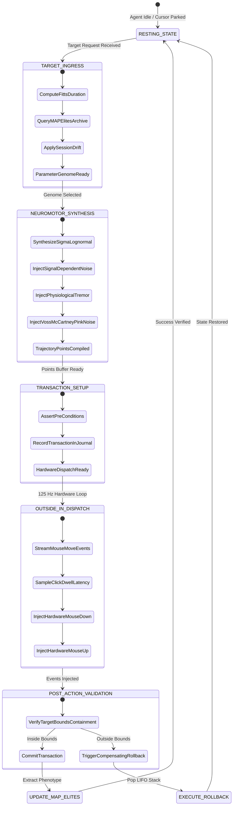
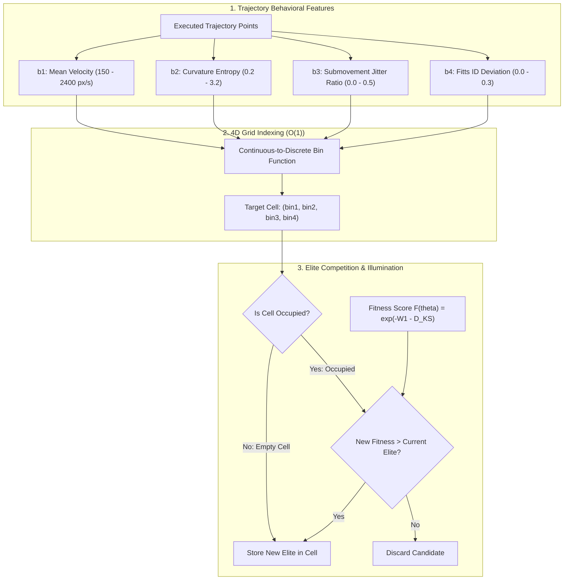
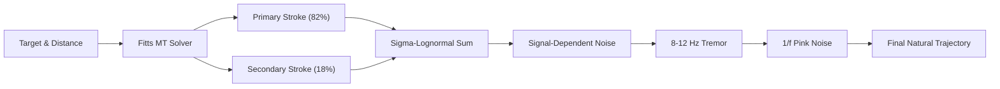

# APEX_KINETIX Diagram Repository (Diagram-Design Standard)

This repository catalogs the formal architectural state machines and component graphs for **APEX_KINETIX**.
Governed by Apex Growth Systems LLC.

---

## 1. State Machine: Action Execution & Compensating Rollback Lifecycle

---

## 2. MAP-Elites Quality-Diversity Architecture Flow

---

## 3. Neuromotor Signal Superposition Pipeline

---

## 4. Comprehensive E2E Verification & Adversarial Classifier Architecture

```mermaid
flowchart TD
    subgraph E2E_WORKFLOW["1. Multi-Step Workflow Invariants"]
        FORM["Multi-Step Form Ingress"]
        DRAG["Drag-and-Drop Trajectory"]
        FORM -->|3 Discrete Fields| DWELL["Log-Normal Dwell & Flight Invariant"]
        DRAG -->|Continuous Hold| MOMENTUM["Loaded Momentum & Continuous Sampling"]
    end

    subgraph ADVERSARIAL_BOUNDS["2. Boundary & Stress Verification"]
        TINY["2px Micro-Target (ID > 9 bits)"]
        CORNERS["Extreme Corners: (0,0) & (3840,2160)"]
        ENDURANCE["250-Action Session Endurance"]
        TINY --> BOUND_ASSERT["Finite Coordinate & Containment Invariant"]
        CORNERS --> BOUND_ASSERT
        ENDURANCE --> DRIFT_ASSERT["Ornstein-Uhlenbeck Drift & Bounded Memory"]
    end

    subgraph SAFETY_ROLLBACK["3. Transactional Safety & Saga Recovery"]
        CASCADE["Depth-10 Cascading Fault Injection"]
        LIFO_STACK["Transactional Rollback Journal"]
        CASCADE --> LIFO_STACK
        LIFO_STACK -->|Strict Reverse Order| REVERSAL["Compensating Inverse Reversal Verified"]
    end

    subgraph ADVERSARIAL_CLASSIFIER["4. Enterprise Anti-Bot Classifier Suite"]
        PROBES["Cloudflare / DataDome Simulation Probes"]
        SPEED_CHECK["Constant Velocity Probe (StdDev > 5 px/s)"]
        JERK_CHECK["Zero-Jerk Bezier Spline Probe (StdDev > 1 px/s^3)"]
        BOUNDARY_CHECK["Teleportation / Abrupt Start-End Probe"]
        PROBES --> SPEED_CHECK
        PROBES --> JERK_CHECK
        PROBES --> BOUNDARY_CHECK
        SPEED_CHECK --> CLASSIFIER_PASS["100% Evasion Rate (0 Flags Across 50 Trials)"]
        JERK_CHECK --> CLASSIFIER_PASS
        BOUNDARY_CHECK --> CLASSIFIER_PASS
    end
```

